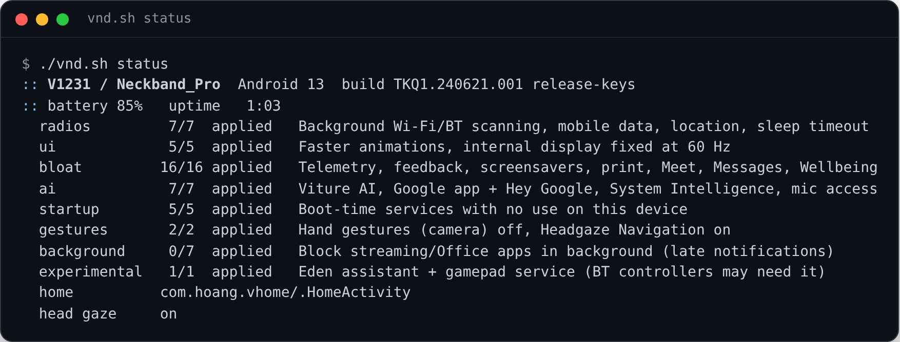
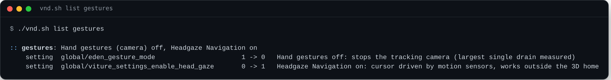
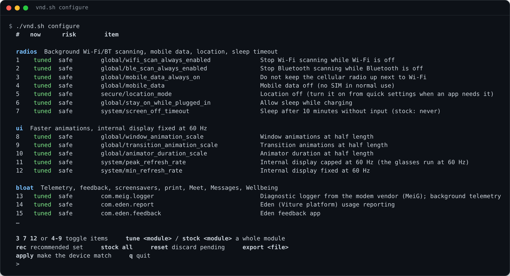
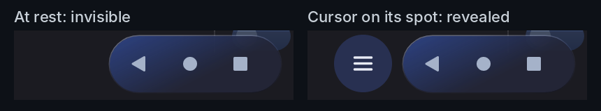
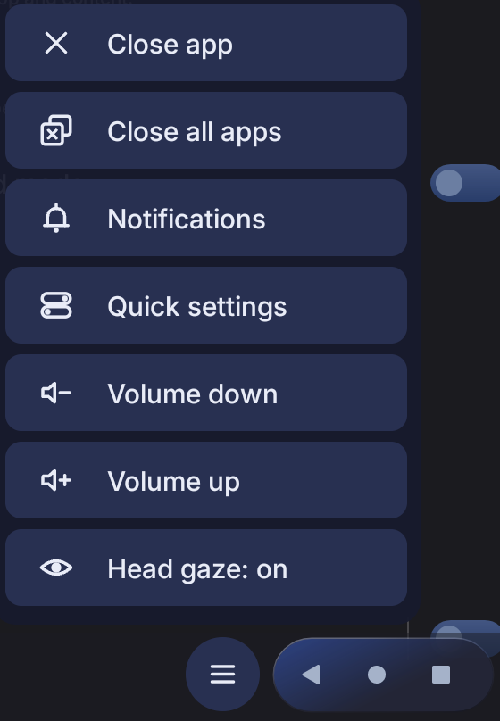
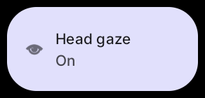

# Viture Neckband Debloater (VND)

**Unofficial community tool. Not affiliated with or endorsed by VITURE. Read the [Disclaimer](DISCLAIMER.md) before use.**

Longer battery life, a quieter system and a microphone that only listens when you ask, for the VITURE Neckband. No root, no uninstalls, no flashing, and every change has an undo.

<p align="center"></p>

---

## Contents

1. [What VND is](#1-what-vnd-is) (including [battery results](#battery-results))
2. [What it changes](#2-what-it-changes)
3. [How it keeps your device safe](#3-how-it-keeps-your-device-safe)
4. [Before you start](#4-before-you-start)
5. [Step-by-step guide](#5-step-by-step-guide)
6. [The configurator](#6-the-configurator)
7. [TV Home and head-gaze navigation](#7-tv-home-and-head-gaze-navigation) (the helper app, its permissions, signing)
8. [Undoing changes](#8-undoing-changes)
9. [Living with a tuned neckband](#9-living-with-a-tuned-neckband)
10. [Using VND with Claude](#10-using-vnd-with-claude)
11. [Command reference](#11-command-reference)
12. [Troubleshooting](#12-troubleshooting)
13. [FAQ](#13-faq)
14. [Contributing](#14-contributing)
15. [Legal](#15-legal)

---

## 1. What VND is

The VITURE Neckband is an Android 13 computer with a Snapdragon 888 processor and active cooling that drives VITURE XR glasses. Out of the box it also runs a hand-tracking camera, two AI assistants, a hotword listener, telemetry services from several vendors and a 3D home environment that keeps a full processor core busy while it is on screen.

VND is a shell script that talks to the neckband over Android's standard wireless debugging (`adb`). It switches those extras off in small, documented modules, records every change in a rollback journal, and includes a 12 KB companion app that makes Google TV your home screen with a quick-settings button for head tracking.

Every item in VND comes from measurement: two days of Android battery statistics, per-process CPU sampling and camera logs on a real device. The method and the numbers are in [docs/FINDINGS.md](docs/FINDINGS.md).

**Supported device:** VITURE Neckband, model `V1231` (Android reports the device as `Neckband_Pro`), tested on Android 13 build `TKQ1.240621.001`. VND refuses to run on anything else unless you pass `--force`.

---

### Battery results

Measured on one refurbished unit (model `V1231`, Android 13, build `TKQ1.240621.001`) with VITURE Beast glasses, using `./vnd.sh battery-test`. **Interim result, 29 October 2026:** the full 100%-to-shutdown run is still in progress, and this table will be replaced by the final figures.

| Setup | Runtime |
|---|---|
| Stock: 3D home, hand gestures, AI services (owner's real-world experience) | about **1 hour** |
| VND `recommended` + TV Home, projected from 100% to 0% | **3 h 21 min** |
| VND `recommended` + TV Home, projected to shutdown if it happens at 20% | **2 h 41 min** |

Conditions of the interim run: 42 minutes from 100% to 79%, a drain of 29.8% per hour, screen always on, head gaze on, hand gestures off, battery at 27 °C on average, mostly Google TV and settings screens in the foreground. Continuous video streaming may raise the drain somewhat. Your unit, firmware and brightness will give different numbers; measure your own with `battery-test`.

## 2. What it changes

Changes are grouped in modules. You can apply a module, a profile of modules, or pick single items in the [configurator](#6-the-configurator).

| Module | What it does | Trade-off | Risk |
|---|---|---|---|
| `radios` | Stops Wi-Fi and Bluetooth "always scanning", turns off mobile data (the neckband has no SIM in normal use) and location, lets the device sleep after 10 minutes and while charging | Apps that need location need it switched back on from quick settings | Safe |
| `ui` | Animations at half length; internal display fixed at 60 Hz | None noticed in the glasses, which run at 60 Hz | Safe |
| `bloat` | Disables telemetry and loggers (modem vendor, Eden/Viture platform, Google feedback), screensavers, print services, Google Meet, Messages, Digital Wellbeing, Maps Timeline, an AOSP sample app | Those apps are unavailable until re-enabled | Safe |
| `ai` | Disables Viture AI and its background service, the Google app (Assistant, "Hey Google", Discover), Android System Intelligence and Private Compute Services; clears the default assistant; revokes microphone access | Voice search, Live Caption and smart suggestions stop working | Moderate |
| `startup` | Disables boot-time services with no use on a neckband: setup restore, system tracing, dynamic system updates, carrier calling (IMS), Qualcomm metrics | None for normal use | Safe |
| `gestures` | Switches hand gestures off (stops the tracking camera) and **Headgaze Navigation** on | Volume keys are disabled while head gaze is on (Viture behavior); see [section 7](#7-tv-home-and-head-gaze-navigation) | Safe |
| `background` | Blocks Teams, Outlook and streaming apps from running in the background | Their notifications arrive late or only when opened | Trade-off |
| `experimental` | Disables Eden's assistant and gamepad service | Bluetooth game controllers may need it | Experimental |

**Profiles:** `recommended` = `radios ui bloat ai startup gestures`. `all` = every module.

To see every single setting with its stock value, and every app with its risk rating and a one-line explanation:

```bash
./vnd.sh list            # everything
./vnd.sh list ai         # one module
```

<p align="center"></p>

---

## 3. How it keeps your device safe

| Safeguard | What it means for you |
|---|---|
| **Nothing is uninstalled** | Apps are disabled with Android's `pm disable-user`. Their data stays; one command brings them back exactly as they were. |
| **No root, no unlocking, no flashing** | VND only uses options Android offers to every user through developer settings. System partitions are never touched. |
| **Never-touch list** | [lists/never_touch.txt](lists/never_touch.txt) protects the XR layer, Viture's launcher and settings, updates, licensing, system UI, Google Play services, the Play Store, the keyboard and Bluetooth. VND refuses to disable them, even with `--force`, and the configurator does not show them. |
| **Rollback journals** | Every run writes the previous value of everything it touched to `state/journals/`. Rollback replays them in reverse. |
| **Restore to stock** | `restore-stock` puts every setting VND knows back to Viture's shipping value and re-enables every listed app, with or without journals. |
| **Dry run** | `--dry-run` prints exactly what would change and changes nothing. |
| **Model check** | VND stops on any device other than the VITURE Neckband. |
| **Remote recovery** | If the glasses ever stop responding, your computer still reaches the neckband over wireless debugging, so you can roll back without touching the device. |

---

## 4. Before you start

### What you need

- A VITURE Neckband with the glasses, charged above 30%.
- A computer on the **same Wi-Fi network** as the neckband (macOS, Linux, or Windows with Git Bash or WSL). A VPN mesh such as Tailscale also works.
- About 20 minutes.

### Install adb (Android platform-tools)

| System | Install | Check |
|---|---|---|
| macOS | Install [Homebrew](https://brew.sh), then `brew install android-platform-tools` | `adb version` |
| Windows | `winget install Google.PlatformTools`, then use **Git Bash** ([git-scm.com](https://git-scm.com)) or **WSL** to run VND | `adb version` |
| Linux (Debian/Ubuntu) | `sudo apt install adb` | `adb version` |
| Any | Download the [official platform-tools](https://developer.android.com/tools/releases/platform-tools), unzip, then `export ADB=/path/to/platform-tools/adb` | `$ADB version` |

`adb pair` needs platform-tools 30 or newer. Recent packages are fine; very old Linux distribution packages may not be.

### Get VND

```bash
git clone https://github.com/hchuynh/Viture-Neckband-Debloater.git
cd Viture-Neckband-Debloater
chmod +x vnd.sh
./vnd.sh help
```

Without git: on the GitHub page choose **Code → Download ZIP**, unzip it and open a terminal in the folder.

Using Claude? You can skip this step and give Claude the repository address instead; see [section 10](#10-using-vnd-with-claude).

---

## 5. Step-by-step guide

### Step 1: Enable Developer options and wireless debugging

On the neckband (menu names can differ slightly between firmware versions):

1. Open **Settings → About** and tap **Build number** seven times until Android says you are a developer.
2. Go back and open **Developer options** (usually under **Settings → System**).
3. Switch on **Wireless debugging** and accept the prompt for your network.
4. Tap **Wireless debugging** to open its screen. Keep it open for the next step.

### Step 2: Pair your computer (once)

On the Wireless debugging screen, tap **Pair device with pairing code**. A popup shows an address with a port and a six-digit code.

```bash
./vnd.sh pair 192.168.1.40:41445 276798      # popup address and code
```

You should see `Successfully paired`. Pairing is remembered; you only repeat it if you revoke authorizations or change computer.

### Step 3: Connect

Close the popup. The top of the Wireless debugging screen shows **IP address & Port**. That port is different from the pairing port.

```bash
./vnd.sh connect 192.168.1.40:44079
```

VND confirms the model, Android version and build. The connection port changes whenever the neckband sleeps, reboots or switches wireless debugging off. When that happens, run `connect` again with the new port; no new pairing is needed.

**Tip:** while you work, raise the screen timeout in Display settings so the neckband does not sleep and drop the connection.

### Step 4: Back up

```bash
./vnd.sh backup --no-media     # settings, app list and install files of your apps
./vnd.sh backup                # the same, plus a copy of shared storage (photos, downloads)
```

Backups go to `state/backups/<date>/`. Android does not allow app data (logins, saved progress) to be copied without root, so a backup restores apps, not their data.

### Step 5: See what is draining your battery

```bash
./vnd.sh analyze
```

The output has four parts:

- **Top processor time since the last battery reset.** This breaks down the "Android System" entry of the battery screen, which hides about 40 processes sharing the system identity, Viture's services included.
- **Hardware energy.** Android's estimate per component: screen, CPU, camera, Wi-Fi, Bluetooth.
- **Camera sessions.** Hand-gesture tracking runs on the camera; a high count means gestures have been active.
- **Live 20-second CPU sample.** What is busy right now.

A full snapshot is saved in `state/snapshots/<date>/`. For a clean reading, run `./vnd.sh reset-stats`, use the device normally for 30 to 60 minutes, and analyze again.

### Step 6: Preview

```bash
./vnd.sh apply recommended --dry-run
```

Every line starting with `would` is a change VND would make. Items already in the desired state are shown with a tick and left alone.

### Step 7: Apply

Either the whole recommended profile:

```bash
./vnd.sh apply recommended
```

or one module at a time, which is the better choice the first time:

```bash
./vnd.sh apply radios
./vnd.sh apply bloat
./vnd.sh apply startup
./vnd.sh apply ui
./vnd.sh apply ai
./vnd.sh apply gestures
```

Each run prints the path of its rollback journal.

### Step 8: Check in the glasses

Sit down and put the glasses on:

- [ ] Moving your head moves a cursor, and a neckband button press clicks.
- [ ] A single press on the neckband Settings key still opens Viture's 3D home; a long press still recenters.
- [ ] Your streaming apps open and play.
- [ ] Wi-Fi and Bluetooth audio work.

If anything is wrong, run `./vnd.sh rollback --last` and see [Troubleshooting](#12-troubleshooting).

### Step 9 (optional): TV Home

```bash
./vnd.sh tvhome install
```

See [section 7](#7-tv-home-and-head-gaze-navigation) for how it behaves.

### Step 10: Confirm and finish

```bash
./vnd.sh status
```

Each module shows how many of its items are applied. Then switch **Wireless debugging off** on the neckband until you need VND again.

---

## 6. The configurator

Modules are the fast path. The configurator is the precise one: every service and setting VND manages, one per line, with its live state on your device.

```bash
./vnd.sh configure
```

<p align="center"></p>

| You type | Effect |
|---|---|
| `14` or `3 7 12` | Switch those items between tuned and stock |
| `4-9` | Switch a range |
| `tune bloat` / `stock bloat` | Set a whole module |
| `rec` | Select the recommended set |
| `stock all` | Select stock for everything |
| `reset` | Discard pending choices |
| `apply` | Show the pending changes, confirm, apply, journal |
| `export my.conf` | Save the current choices to a file |
| `q` | Quit without applying |

Items marked `n/a` are not installed on your device. Apps on the never-touch list never appear.

### Configuration files

```bash
./vnd.sh configure --export my.conf             # one editable line per item
./vnd.sh configure --import my.conf --dry-run   # preview what the file would change
./vnd.sh configure --import my.conf             # make the device match it
```

A line looks like this:

```
T bloat        com.meig.logger                    # [safe] Diagnostic logger from the modem vendor (MeiG)
```

`T` means tuned (debloated), `S` means stock. Change the letter, save, import. Keep one file per use case, share yours with other owners, or let Claude edit it for you. Configuration files contain only item names and choices, no personal data.

---

## 7. TV Home and head-gaze navigation

### The helper app in one minute

**TV Home** (`com.hoang.vhome`, about 20 KB) is a small companion app that ships with VND in [tvhome/](tvhome/), source code included. VND's script changes settings; TV Home adds the few things a settings change cannot do. It has four parts:

| Part | What it does | Why it is needed |
|---|---|---|
| **Home toggle** | Home opens Google TV; Home again opens the stock app list | Android only lets a real home app decide what Home opens |
| **Head gaze at startup** | Switches Headgaze Navigation on at every boot | Viture's firmware switches it off at each restart |
| **Head gaze button** | A quick-settings button to switch head tracking on and off | Viture disables volume keys while head gaze is on |
| **Floating controls** | A hidden ☰ button in the taskbar, also opened by a controller's Menu key, with Close app, Close all, Notifications, Quick settings, Volume and Head gaze | The plain interface relies on swipes and drags a head-gaze cursor cannot perform |

It has no screen of its own, no background activity beyond the startup check, **no internet permission**, no analytics, and it stores nothing.

### What it enables, and why

`./vnd.sh tvhome install` grants each of these over adb; none of them needs root.

| Permission or role | Used for | How to revoke |
|---|---|---|
| **Default home app** | Deciding what Home opens | Settings → Apps → Default apps → Home app |
| **Usage access** | Knowing which app was last in front, so Home can toggle between Google TV and the app list | Settings → Apps → Special app access → Usage access |
| **Write secure settings** (`WRITE_SECURE_SETTINGS`, grantable only over adb) | Switching Viture's head-gaze setting from the button, the panel and at boot | `adb shell pm revoke com.hoang.vhome android.permission.WRITE_SECURE_SETTINGS` |
| **Run at startup** (`RECEIVE_BOOT_COMPLETED`) | The head-gaze check after each boot | Uninstall the app |
| **Accessibility service** "TV Home controls" | Drawing the controls over full-screen apps, performing the Recents swipe to close apps, opening notifications and quick settings, listening for the controller's Menu key | Settings → Accessibility → TV Home controls |
| **Quick-settings tile** | The Head gaze button in the pull-down panel | Edit the quick-settings panel |

`./vnd.sh tvhome uninstall` removes the app and all of the above in one step, and the `tvhome` rollback journal restores the previous home app and accessibility settings.

### Why the app is signed with a private key

Android installs only apps that carry a digital signature. The signature does not unlock anything or grant permissions; it identifies the publisher, and Android uses it to accept an **update** only when it is signed with the same key as the installed copy. That is what stops someone from replacing your app with a modified version.

- **To install the prebuilt app, you need nothing.** `tvhome/TVHome.apk` is already signed by the maintainer, and `tvhome install` installs it.
- **The maintainer's private key is not in this repository and never will be.** Anyone holding it could publish fake updates that Android would accept over your copy. `.gitignore` blocks key files from being committed.
- **You can check the signature yourself.** With the Android build tools: `apksigner verify --print-certs tvhome/TVHome.apk`. The official build's certificate SHA-256 fingerprint is
  `f3b8e7b88ac32dcdf4315f0250ce0003933d1685059b45979d0dbd38cc2c4287`.
- **If you build the app from source**, `tvhome/build.sh` creates a key of your own (`tvhome/tvhome.keystore`). Keep it if you want to update your own build later. Because your key differs from the maintainer's, Android refuses to install your build over the official one; `tvhome install` detects this, uninstalls the old copy and installs yours.

### Why head gaze matters

The plain Android interface has no pointer for the neckband buttons, which is why most owners stay in Viture's 3D home or keep the phone remote app open. The 3D home is also the single most expensive thing the device does. **Headgaze Navigation**, switched on by the `gestures` module, gives you a cursor driven by the glasses' motion sensors in the plain interface, so you can leave the 3D home and still navigate with your head. It does not use the camera.

### What TV Home does

| You do | Result |
|---|---|
| Press Home from any app or from the app list | Google TV opens |
| Press Home while Google TV is in front | The stock app list opens |
| Press Back out of Google TV | The stock app list opens |
| Restart the neckband | It starts in Google TV, with head gaze switched on |
| Single press on the neckband Settings key | Viture's 3D home, unchanged |
| Long press on the Settings key | Recenter, unchanged |

TV Home has no interface of its own and uses practically no resources. It needs permissions that `tvhome install` grants over adb: **usage access**, to know whether Google TV is in front; **secure settings**, for the head-gaze button and startup routine; and the **accessibility service** for the floating controls. It requires the Google TV app to be installed.

### Floating controls

The plain Android interface relies on gestures a head-gaze cursor cannot perform: closing an app means swiping its card up in Recents, and the notification shade only opens with a drag from the top edge. Full-screen apps also hide the taskbar.

TV Home adds a **☰ button** in the taskbar row, just left of Back, Home and Recents, in the same shape and color. It is **invisible until you move the cursor onto its spot**, then fades in; it fades out again about 1.5 seconds after the cursor leaves. It works the same over full-screen apps that hide the taskbar, without covering them. Click it to open a panel above it:

<p align="center"></p>
<p align="center"></p>


| Button | What it does |
|---|---|
| **Close app** | Closes the app you are using (opens Recents, swipes its card up, returns Home) |
| **Close all apps** | Clears Recents (uses Android's Clear all button when available, otherwise swipes each card) |
| **Notifications** | Opens the notification shade |
| **Quick settings** | Opens quick settings |
| **Volume down / up** | Changes media volume, also while head gaze has the volume keys disabled |
| **Head gaze** | Switches head tracking on or off |

The panel stays open until you **click outside it** or **click the ☰ button again**. Volume and Head gaze keep it open, so you can press Volume up several times in a row; Close app, Close all, Notifications and Quick settings close it because they take you somewhere else. A click outside the panel also reaches whatever is underneath, as with any Android overlay, so click an empty area to close it.

**From an external controller.** The **Menu** key opens and closes the panel too. Touchpad remotes such as the CheerTouch have a dedicated Menu button, which modern Android apps ignore, so nothing is lost by giving it this job. The key is consumed and does not also reach the app underneath. To use a different key, or switch this off:

```bash
adb shell settings put global vnd_menu_key 82    # 82 = Menu (default); any Android key code works
adb shell settings put global vnd_menu_key 0     # off
```

The invisible spot still answers clicks, so it works even if a cursor never sends hover events. It is the size of one taskbar button; the rest of the screen is unaffected. The icons are original line drawings made in code, so the app bundles no third-party icon set.

The controls run as an Android **accessibility service** called *TV Home controls*, the only kind of app allowed to draw over full-screen apps and perform gestures without root. It reads the Recents screen only when you press a Close button, does nothing in the background, and stores or sends nothing. `tvhome install` enables it next to any accessibility services you already use; `tvhome uninstall` removes only it. You can also switch it off in **Settings → Accessibility → TV Home controls**.

Closing apps is about tidiness, not battery: Android's app freezer already freezes apps left in the background after about 10 minutes, so they stop using power.

### Head gaze at every startup

Viture's firmware switches Headgaze Navigation off at every boot. TV Home switches it back on as soon as the device starts, then checks again after 20 seconds, 1 minute and 3 minutes, while Viture's XR layer finishes starting. You can still switch it off during a session with the button below; the next restart turns it on again.

### The Head gaze button



`tvhome install` adds a **Head gaze** button to the pull-down quick settings panel. Tap it to switch head tracking on or off. Viture disables volume keys while head gaze is on, so this is also the quick way to change volume: switch it off, adjust, switch it on.

### Removing TV Home

```bash
./vnd.sh tvhome uninstall
```

Without a computer: **Settings → Apps → Default apps → Home app** and choose the stock launcher.

### Building it yourself

The source is in [tvhome/](tvhome/). With a JDK and the Android SDK:

```bash
BUILD_TOOLS=~/Android/Sdk/build-tools/34.0.0 ANDROID_JAR=~/Android/Sdk/platforms/android-33/android.jar ./tvhome/build.sh
```

A self-built APK is signed with your own key; see [Why the app is signed with a private key](#why-the-app-is-signed-with-a-private-key).

---

## 8. Undoing changes

From the most precise to the most complete:

| Command | Undoes |
|---|---|
| `./vnd.sh journals` | Lists every journal (`.undone` marks those already rolled back) |
| `./vnd.sh rollback --last` | The latest run |
| `./vnd.sh rollback <journal>` | One specific run |
| `./vnd.sh rollback --all` | Every run, newest first |
| `./vnd.sh configure` → `stock all` → `apply` | Everything, item by item, with a preview |
| `./vnd.sh restore-stock` | Every setting to Viture's stock value, every listed app re-enabled, TV Home removed |

Without a computer, a disabled app can be re-enabled from **Settings → Apps → See all apps → (app) → Enable**. A factory reset restores everything in the worst case, and erases your data.

---

## 9. Living with a tuned neckband

- **Sleep instead of shutting down.** A short press on the power button sleeps the device; it resumes in about a second. Deep sleep uses very little battery. Unplug the glasses for long pauses.
- **Brightness is your biggest remaining lever.** The neckband powers the glasses; lower brightness and the dimming level save more than any setting.
- **Avoid resting in the 3D home.** Open your app and stay there, or use TV Home.
- **Watch the Settings key double press.** It switches hand gestures, and the camera, back on. Double press again to switch them off, or run `apply gestures`.
- **After a Viture system update,** run `./vnd.sh status`. Updates can re-enable system apps; `apply recommended` puts your choices back.
- **Location.** Switch it on from quick settings when an app needs it.

---

### Measure your battery life

Battery estimates on the screen are averages of recent history and lag behind changes. VND includes a real test that logs the battery once per minute on the neckband itself, so it keeps running when wireless debugging disconnects.

```bash
./vnd.sh battery-test start      # resets battery statistics and starts the logger
./vnd.sh battery-test status     # check it is running, see the latest lines
./vnd.sh battery-test report     # after the test: runtime, drain per hour, milestones
```

For a result you can compare with other owners:

1. Charge to 100%, then unplug. The report counts from the first minute unplugged at 100%.
2. Use the device as you normally do, glasses on, with the same brightness throughout. Streaming video is the most common reference.
3. Let it run until the neckband shuts down. If the automatic power-off timer is enabled on your unit, switch it off first so it does not end the test early.
4. Restart the neckband, `connect` again and run `battery-test report`.

The report shows start and end, duration, drain per hour, projected time from 100% to 0%, the time at which each 10% step was reached, the share of time with the screen on, head gaze and hand gestures, battery temperature and the apps in the foreground. The log stays on your computer in `state/` and on the neckband in `Download/vnd_battery_test.csv`.

## 10. Using VND with Claude

VND was built with Claude and is designed so anyone can let Claude operate it. There are two ways to start.

### Point Claude at the repository (no download needed)

You do not have to download or unzip anything. Give Claude the repository address and it creates its own working folder, clones VND into it and operates from there; journals, backups and snapshots stay in that folder's `state/` directory.

> Use the Viture Neckband Debloater from https://github.com/hchuynh/Viture-Neckband-Debloater to tune my VITURE Neckband. Clone it into a working folder, read CLAUDE.md first and follow it. Pair with `<ip:pairing-port>` code `<code>`, connect to `<ip:port>`, take a backup and an analysis, explain the results in plain words, and show me the dry run of `recommended`. Wait for my OK before applying anything.

### Or open a folder you already downloaded

Open the VND folder in an environment where Claude can run commands and paste the same request, replacing the first sentence with "Use the Viture Neckband Debloater in this folder".

### Where Claude must run

`adb` has to reach the neckband over your network, so Claude must work **on a computer in the same network as the neckband**: Claude Code on your computer, or a Claude desktop session linked to your computer. A session running only in the cloud cannot see devices on your home Wi-Fi unless you connect them through a private network such as Tailscale and give Claude that address. If Claude says the device is unreachable, check this first.

### What Claude follows

[CLAUDE.md](CLAUDE.md) gives the agent its operating rules: back up first, dry-run before applying, never touch the protected list, ask before `experimental` and `background`, use configuration files for per-item choices, ask for the new port when the connection drops, and have you check in the glasses after `gestures`. It also asks you to accept the [Disclaimer](DISCLAIMER.md) before the first change. Review its proposals before approving them.

---

## 11. Command reference

```
Setup
  pair <ip:port> <code>        pair once
  connect <ip:port>            connect and remember the target

Look
  status                       what is applied, module by module
  list [module]                every change, stock value and risk
  analyze                      snapshot + battery and CPU ranking + live CPU sample
  reset-stats                  reset battery statistics for a clean measurement

Change
  configure                    interactive per-item configurator
  configure --export <f>       save current choices to an editable file
  configure --import <f>       make the device match a file
  apply <module...>            radios ui bloat ai startup gestures background experimental
  apply recommended | all
  tvhome install | uninstall   Google TV home + Head gaze button

Undo
  journals                     list rollback journals
  rollback --last | --all | <journal>
  restore-stock                everything back to Viture's stock values

Safety
  backup [--no-media]          settings, app list, apks, shared storage

Measure
  battery-test start [--keep]  log battery every minute on the device (--keep: append to the current log)
  battery-test status | stop
  battery-test report          runtime, drain per hour, milestones, conditions

Flags
  --dry-run                    show, change nothing
  --yes                        no confirmation prompts
  --force                      skip the model check (unsupported devices)

Environment
  ADB=/path/to/adb             use a specific adb
  VITURE_TARGET=ip:port        override the saved target
  VND_NO_MDNS=1                work around adb mDNS crashes in some VMs
```

---

## 12. Troubleshooting

| Symptom | Cause and fix |
|---|---|
| `adb not found` | Install platform-tools (section 4) or set `ADB=/path/to/adb`. |
| `device unreachable` or `Connection refused` | The connection port changed. Open Wireless debugging and `connect` to the new **IP address & Port**. |
| `failed to authenticate` or `unauthorized` | Pair again (step 2). Accept the prompt on the neckband if one appears. |
| `adb pair` is not a known command | Your adb is older than platform-tools 30. Install a current version. |
| adb crashes with `fdsan` or `daemon didn't ACK` | Some adb builds crash on mDNS inside virtual machines. Prefix commands with `VND_NO_MDNS=1`. |
| `this is '…', not a VITURE Neckband` | VND only supports model `V1231`. `--force` overrides it at your own risk. |
| Volume keys do nothing | Head gaze is on (Viture behavior). Use the floating ☰ button → Volume, or switch head gaze off. |
| Hand gestures came back | A double press on the Settings key toggles them. Double press again or `apply gestures`. |
| No cursor in the plain interface | Head gaze is off. Use the floating ☰ button → Head gaze, or `apply gestures`. |
| The ☰ button is missing | It is invisible until the cursor hovers over its spot, just left of Back/Home/Recents. If it never appears, the accessibility service is off: Settings → Accessibility → TV Home controls, or run `tvhome install` again. |
| Close app did nothing | Recents took longer than usual to open. Press it again; on a slow first launch after boot this can happen once. |
| A Bluetooth controller stopped working | Roll back the `experimental` journal or `configure` → set `com.eden.vaservice` to stock. |
| An app you need is missing | It was disabled. `configure`, set it to stock, `apply`. |
| Something came back after a system update | Updates can re-enable apps. `status`, then `apply recommended`. |
| Battery estimate still looks low | Android averages recent history. `reset-stats`, use the device 30 to 60 minutes, `analyze`. |
| Windows: `bash: ./vnd.sh: No such file` | Run it from Git Bash or WSL, not PowerShell or cmd. |

When opening an issue, include the output of `./vnd.sh status` and the failing command. **Do not attach the `state/` folder**; it contains your device data.

---

## 13. FAQ

**Can this brick the device?**
It is designed to make that very unlikely. VND never flashes, roots or uninstalls, and the components the device needs to start, display and update are on the never-touch list. Disabled apps can always be re-enabled over adb. A factory reset restores everything in the worst case.

**Does it void the warranty?**
VND uses developer options available to every Android user and changes settings for your user profile only. Whether that affects your warranty depends on VITURE's terms and your local law; check them. See the [Disclaimer](DISCLAIMER.md).

**Will I lose data?**
No app data is deleted. Disabled apps keep their data and come back as they were.

**Does VND collect anything?**
No. It runs on your computer, talks only to your neckband and has no analytics.

**How much battery does it save?**
It depends on how you use the device. The largest savings come from switching hand gestures off and from not resting in the 3D home; [docs/FINDINGS.md](docs/FINDINGS.md) shows what was measured on one unit.

**Why does a streaming stick seem more frugal?**
A streaming stick runs on wall power, sends decoded video straight to HDMI and has no displays to feed. The neckband powers the glasses from its battery, composes every frame through the XR layer for a virtual screen, and runs phone Android on a flagship phone chip. Details in [docs/FINDINGS.md](docs/FINDINGS.md).

**Does it work on other VITURE products?**
VND targets the VITURE Neckband (model `V1231`). Other devices may use some of the same package names, but the model check refuses them unless you pass `--force`, and you would be testing on your own.

**How do I update VND?**
`git pull` in the folder, or download the new ZIP. Your `state/` folder (journals, backups) stays untouched.

---

## 14. Contributing

Contributions are welcome, especially measurements from other firmware versions.

- **Adding an app or setting** to a list needs evidence: what the package does, how you measured its cost or confirmed it is unused, and what breaks without it. Use the existing format (`package|risk|what it is`).
- **Never move items out of** `lists/never_touch.txt` without a test on a real device and a rollback plan in the pull request.
- **Do not commit** device snapshots, backups, signing keys or anything from `state/`.
- **Do not add** VITURE firmware files, extracted APKs, logos, screenshots of copyrighted UI or text copied from VITURE documentation. Link to public sources and paraphrase.
- **Screenshots** in `docs/img/` show only VND and TV Home over neutral Android screens. Any screenshot with third-party content (posters, artwork, other brands' icons) or personal data (account names, network names, profile pictures) must be blurred before it is committed.
- Keep `vnd.sh` compatible with bash 3.2 (macOS default) and run `shellcheck` before submitting.

---

## 15. Legal

VND is released under the [MIT License](LICENSE). Read the full [Disclaimer](DISCLAIMER.md): unofficial project, no warranty, warranty and terms of service, security of wireless debugging, privacy, physical safety, AI agents, trademarks and copyright.

VITURE and related product names are trademarks of their respective owner. Android, Google, Google TV, Google Play, Chromecast and YouTube are trademarks of Google LLC. Qualcomm and Snapdragon are trademarks of Qualcomm Incorporated. All other product names are trademarks of their respective owners. They are used only to identify compatible products, and their use implies no affiliation or endorsement.

The repository contains no VITURE firmware, code, images, logos or documentation. Facts about VITURE's behavior are paraphrased from public sources such as [VITURE Academy](https://www.viture.com/academy/neckband/pro).
