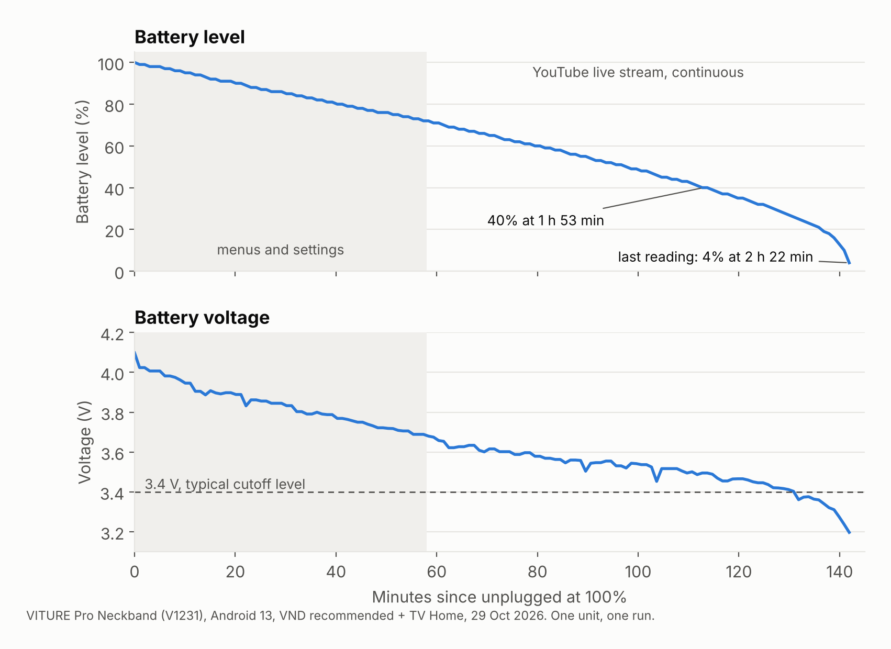

# Findings

Measurements taken on one VITURE Neckband (`V1231`, Android 13, build `TKQ1.240621.001`, Qualcomm SM7325, 8 GB RAM, 128 GB) paired with VITURE Beast glasses, on 28 and 29 October 2026. They describe that device on that firmware. Re-run `./vnd.sh analyze` on yours: your numbers will differ, and newer firmware may change the picture.

## Method

- **Battery statistics** (`dumpsys batterystats`): Android's energy model per hardware component and per UID, plus CPU time per process.
- **Per-process CPU sampling**: two reads of `/proc/<pid>/stat` 20 to 30 seconds apart, converted to percent of one core.
- **Discharge steps**: the time Android logs for each 1% of battery, the most direct view of real drain.
- **Camera log** (`dumpsys media.camera`): which package opened the camera and when.

## 1. The hand-tracking camera was the largest single drain

In the first battery cycle the camera accounted for about 546 mAh out of roughly 2,800 mAh used, close to 20% of the battery, over almost 90 minutes. The camera log attributes it to `com.viture.xr`, and the matching Viture setting was `eden_gesture_mode=1`. The camera hardware service alone accumulated about 46 minutes of CPU time.

**Action:** `gestures` module (gestures off). Head tracking uses the motion sensors, and the camera stayed closed throughout head-gaze use.

## 2. "Android System" hides about 40 processes

The battery screen shows one "Android System" entry for UID 1000. On this device that UID is shared by every Viture and Eden package (all signed with the same key) plus vendor services. Ranked by CPU time in one cycle:

| Process | CPU time | Notes |
|---|---|---|
| `com.viture.launcher` (Viture 3D home) | ~74 min | ~1 core fully busy while on screen (1 h 11 min in foreground) |
| `com.viture.xr` | ~52 min | the XR compositor, unavoidable |
| camera hardware service | ~46 min | gesture tracking |
| `com.viture.aiservice` | ~15 min | idle AI service, restarted 5 times |
| `com.eden.settings:drmService` | ~1 min | |

Disney+ and YouTube, while actually playing video, used less CPU than the 3D home.

**Action:** `ai` module disables the AI service; head gaze plus TV Home let you leave the 3D home.

## 3. Runtime: before and after

**Before.** With the stock setup (3D home, hand gestures, AI services), the owner's real-world runtime was about 1 hour. Android's average across the first battery cycle (about 1.5 A) understated the worst case, because it mixed heavy stretches with lighter ones; with the camera, the 3D home and the AI service active together the draw is far higher.

**After.** With VND `recommended` and TV Home, one `battery-test` run from 100% to automatic shutdown lasted **2 h 22 min** (29 October 2026):

| Phase | Minutes | Level | Voltage | Drain |
|---|---|---|---|---|
| Menus and settings | 0 to 58 | 100% to 72% | 4.10 to 3.69 V | 29.3% per hour |
| YouTube live stream, steady | 58 to 112 | 72% to 41% | 3.68 to 3.49 V | 34.9% per hour |
| YouTube live stream, end | 112 to 142 | 40% to 4% | 3.50 to 3.20 V | 74% per hour (reported) |

**The end of the curve is the battery, not the software.** Load and conditions did not change in the last phase; the reported level dropped twice as fast because the voltage went below about 3.4 V under a load of roughly 1 A, and the fuel gauge corrected itself downwards. The device did not shut down at a fixed 20%: it ran to about 4% and switched off between 2 h 21 and 2 h 23 min. At the steady streaming rate, a healthy cell would have lasted roughly 2 h 50 min. Android's capacity estimate (3,474 mAh, above the rated 3,280 mAh) does not reflect this wear, so the voltage curve under load is the better indicator.

**Power.** At 30 to 35% per hour of a battery of about 13 Wh, the system draws roughly 4 to 4.5 W. Most of it is the glasses' displays and the XR composition, which no setting removes; brightness is the main lever left. Head-gaze navigation measured at about 9% of total CPU load during streaming.

**Android's on-screen estimate lags.** After large changes it still weights the old, heavier history. `reset-stats` and 30 to 60 minutes of use give a clean reading; the `battery-test` log is the ground truth.

## 4. Where the remaining power goes

- **The glasses.** The neckband powers both micro-OLED displays, dimming, speakers and sensors over the cable. Brightness is the biggest lever left.
- **Two displays.** Android keeps an internal 1080p display (where apps run) and an HDMI display for the glasses; the XR layer places the first onto the second. Both are composed continuously.
- **The XR service** at rest: ~9% of one core; ~17% while moving the head-gaze cursor.

## 5. Small consumers, kept for privacy and memory

- The Google app held ~330 MB across three processes; its energy share was well under 1%.
- Android System Intelligence did not register as a measurable consumer.
- Eden's assistant + gamepad service (`com.eden.vaservice`): zero CPU in a 20-second sample, ~100 MB of RAM, never used the microphone according to app-ops.
- Radios: Wi-Fi/Bluetooth "always scanning" and "mobile data always on" were enabled with no SIM installed.

## 6. Why a Chromecast seems more efficient

A Chromecast draws wall power, its TV powers the panel, and decoded video goes from the decoder straight to HDMI without waking the CPU. The neckband powers the glasses from its battery, routes every frame through the XR compositor for a virtual screen with head-tracked reprojection, composes two displays, and runs full phone Android on a phone-class chip whose idle floor is higher than a small TV chip's. Per watt delivered to the eyes it is reasonable; the waste was in the optional extras.

## 7. Head gaze: why the pointer cannot be centred

Owners asked for a fixed pointer in the middle of the view, with the screen moving under it, as an alternative to the free-moving cursor.

- **Where head gaze runs.** The cursor is computed inside Viture's XR service (`com.viture.xr`), which runs as the system user. It turns head orientation into a pointer position after a recentre, and switches the display mode while head gaze is on, restoring the default "smooth follow" mode when it stops.
- **No switch for it.** Head gaze reads only two settings: `viture_settings_enable_head_gaze` and `viture_settings_forbid_head_gaze`. `eden_cursor_mode` exists but changes nothing visible.
- **No way in for other apps.** The XR service and its head-pose data are protected by a signature permission, so only Viture-signed software can bind to them. A third-party app cannot read head orientation, so it cannot draw its own centred pointer either.

A centred pointer therefore needs a change in Viture's firmware. TV Home leaves head gaze as Viture designed it.

## 8. Buttons

The neckband reports four buttons: Volume up and Volume down (also used to click while head gaze is on), Power, and a mode button that Android sees as `F4`. Power and the mode button are handled by the system before accessibility services receive them, so TV Home can remap the volume buttons (while head gaze is off) and any controller button, not those two. While head gaze is on, the volume buttons do not reach apps either: Viture turns them into click and Back itself, which a key log confirmed, so long presses cannot be used for shortcuts.

## Things deliberately left alone

`com.viture.xr`, `com.viture.launcher`, `com.eden.settings`, `com.eden.systemupgrade`, `com.eden.license.service`, Play services and the system UI. Disabling them risks the glasses' interface, updates or licensing, which no battery gain justifies.
